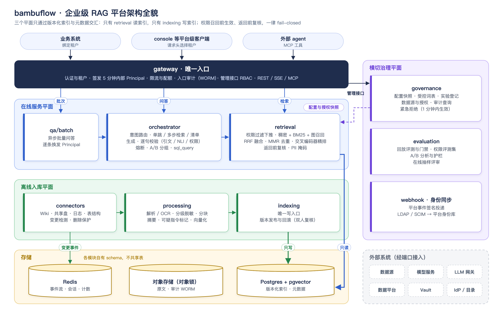
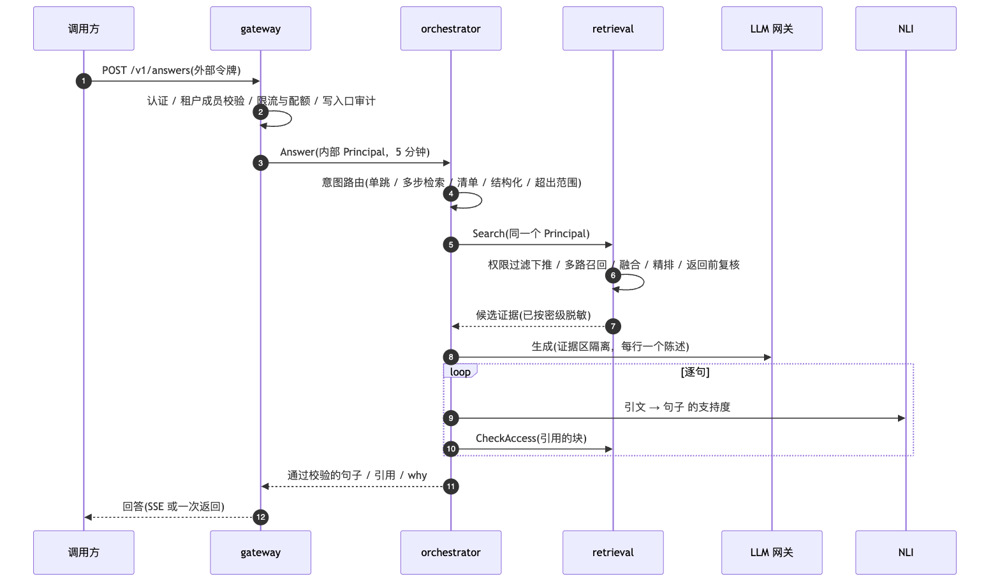

# bambuflow

企业级 RAG 平台：把公司内部的文档、邮件、Wiki、图片、表格、日志和结构化数据接进来，在**权限之内**回答问题。
每个回答都带引用、引文片段与来源元数据，逐句校验有证据支撑，并在 `why` 里记下影响回答的全部版本号，可以审计、可以回放。

覆盖的能力：多类型数据的入库管道（文档、邮件、Wiki、图片、表格、日志、结构化数据源，含 OCR、增强、向量化与可回滚的增量索引）、
混合检索与图召回、多步检索与工具调用、有据回答与逐句校验、RBAC/ABAC 与数据分级脱敏、审计与密钥管理、
数据治理与溯源、离线评测与回归门禁、在线评估与 A/B。

## 系统架构全貌



图里只画模块之间的主干调用；Vault（密钥与签名）、IdP 与公司目录（身份同步）、可观测性等横切依赖未画出。模块之间只通过 [`contracts/`](contracts/) 生成的接口通信，不共享数据库；
各模块在同一个 Postgres 里用各自的 schema（`idx`、`governance`、`orchestrator`、`evaluation` 等），彼此不读对方的表。

## 架构说明

### 三个平面

| 平面 | 模块 | 职责 | 与其他平面的交汇点 |
| --- | --- | --- | --- |
| 在线服务 | gateway、orchestrator、retrieval、qa/batch | 认证与租户、问答编排、检索与权限过滤、批量问答 | 只读版本化索引；拉取 governance 的配置快照 |
| 离线入库 | connectors、processing、indexing | 变更检测、解析与增强、向量化、写入并发布索引版本 | 只写版本化索引与元数据 |
| 横切治理 | governance、身份同步、webhook、evaluation | 配置与策略、数据源与授权、紧急拒绝、审计查询、评测与 A/B | 以快照、事件和服务间接口影响前两个平面 |

三个平面只通过**版本化索引和元数据**交汇：只有 retrieval 读索引，只有 indexing 写索引。

### 关键约定

- **权限在召回前生效、返回前复核**：retrieval 把调用者的权限编译成过滤条件下推到召回，返回前再按块复核一次；
  orchestrator 的逐句校验还会对引用的块做权限复核。权限与溯源环节一律 fail-closed：拿不到授权、策略或身份时拒绝，不放行。
- **未经校验的陈述不离开 orchestrator**：模型按“每行一个 JSON 单元”输出，逐句做引文核对、NLI 支持度判定与权限复核，
  不通过的句子不发送；计算句由程序重算取数；可疑指令标记的块不能成为唯一依据。
- **每个版本号都写进 why**：索引版本、策略版本、嵌入 / 精排 / 生成 / NLI 模型、提示词版本、配置快照、实验分组等，
  回放时据此还原。
- **身份只由 gateway 签发**：外部令牌在 gateway 换成 5 分钟有效的内部 Principal（数据接口带租户，管理接口只带平台角色），
  内部服务只认 Principal，工具调用都带着调用者原始的 Principal，agent 无法提权。
- **外部系统一律经端口接入并自带默认实现**（ADR-13）：LLM 网关、模型服务、日志平台、数据平台的只读查询服务、身份目录等，
  外部团队的回答只改部署配置，不改设计。
- **审计不可用即停服**：入口审计先写本地持久队列，再送往开启对象锁的桶；写不进去就拒绝请求。

### 一次问答



多跳、比较与结构化问题走 agent 路径：最多 3 轮、每轮最多 4 次工具调用（doc_search；租户开放时另有只读 sql_query），
预算用尽或证据不足时返回 `insufficient_evidence`，不编造答案。关系类问题走单跳路径并提高图召回的权重。枚举、计数与主题汇总走清单路径：先计数再列出，
回答末尾带统计口径说明。

### 模块一览

| 目录 | 语言 | 职责 |
| --- | --- | --- |
| `services/gateway` | Go | 唯一入口：认证、租户、Principal 签发与换发、限流与配额、入口审计、MCP、管理接口分发与 RBAC |
| `services/qa/orchestrator` | Python | 问答编排：意图路由、单跳、agent 多步检索、清单路径、生成与逐句校验、A/B 分组、回答记录 |
| `services/qa/batch` | Go | 异步批量问答：逐条换发 Principal 后调 orchestrator |
| `services/retrieval` | Go | 唯一的索引读入口：权限过滤、混合召回、图召回、精排、返回前复核、文档清单与计数 |
| `services/ingestion/connectors` | Go | 数据源接入：变更检测、清单轮询、删除保护、日志订阅、表结构同步 |
| `services/ingestion/processing` | Python | 解析与 OCR、分级脱敏、分块、摘要与关键词、受控元数据、可疑指令标记、向量化 |
| `services/indexing` | Go | 唯一的索引写入口：写入、版本发布与回滚（双人复核）、拒绝名单 |
| `services/governance` | Go | 配置快照、受控词表、数据源注册与授权、紧急拒绝、实验登记、审计查询、身份同步、Webhook 投递 |
| `services/evaluation` | Python | 回放评测与门禁、A/B 分析与护栏、在线抽样评审 |
| `libs/` | Go / Python | 被至少两个模块使用的库：平台库（日志、遥测、Principal 校验）、逐句校验、受控词表、中文分段 |
| `contracts/` | proto / OpenAPI | 模块之间与对外的全部接口，生成的代码在 `contracts/gen` |
| `deploy/` | Compose / Helm | 开发环境（`deploy/compose`）、生产 chart（`deploy/helm/bambuflow`）、工具容器 |
| `golden/` | — | 评测集与基线 |
| `tools/` | — | e2e、权限评测集、依赖与术语检查、测试数据与模拟服务、Helm 冒烟测试 |

### 对外接口

| 接口 | 说明 |
| --- | --- |
| `POST /v1/answers`、`GET /v1/answers/{answer_id}`、`POST /v1/answers/{answer_id}/feedback` | 问答（可 SSE）、回放、反馈 |
| `POST /v1/search`、`GET /v1/documents/{doc_id}/preview` | 检索、引用预览 |
| `POST /v1/batches` 等 | 异步批量问答 |
| `/mcp` | MCP 工具（只读） |
| Webhook 事件 | 批次完成、索引上线、数据源撤销等 |
| `/v1/admin/...` | 管理接口：紧急拒绝、数据源与授权、索引版本、审计查询、实验与 A/B 分析、在线质量趋势 |

完整定义见 [`contracts/openapi/v1/openapi.yaml`](contracts/openapi/v1/openapi.yaml)。路径 kebab-case，字段 snake_case，
对外 ID 带类型前缀（`ans_`、`conv_`、`bat_`、`src_`、`exp_` 等）。

## 能力对照

每项能力落在哪里、怎么验证。“部分”表示已有基础能力、设计里的完整形态还没做完；e2e 用例在 `tools/e2e/e2e_tests/`。

| 能力 | 做法 | 主要代码 | 验证 |
| --- | --- | --- | --- |
| 混合检索 | 稠密向量 + 关键词（BM25）多路召回，元数据与权限过滤下推到召回，加权 RRF 融合 | `services/retrieval/internal/search/`（`service.go`、`filter.go`、`fuse.go`） | 单测；`test_answers.py`；评测集 Recall@10 |
| 多阶段召回与精排 | 召回 → 融合 → 去重与多样性 → 交叉编码器精排（bge-reranker-v2-m3）→ 精排分下限 | `search/fuse.go`、`internal/embed/rerank.go` | 单测；T2Retrieval 子集的只检索评测（`make eval-retrieval`） |
| 去重与多样性 | 近重复去重、同文档限量、MMR（λ = 0.7） | `search/fuse.go` 的 `diversify` | 单测 |
| Graph RAG | 入库抽取实体与关系（每条边挂证据块），检索做 1–2 跳图召回，只沿可见证据的边走；路径写进 `why.graph_path` | `processing/graph.py`、`indexing/internal/writer/graph.go`、`search/graph.go` | `test_graph.py`；权限评测集的图召回用例 |
| 多步检索与工具调用 | agent 状态机：规划 → 并行检索 → 充分性判断，最多 3 轮 × 4 次调用，硬时间预算；工具 doc_search、只读 sql_query | `orchestrator/agent.py`、`structured.py` | `test_agent.py`、`test_structured.py`；`test_agentic.py`、`test_structured_query.py` |
| 上下文构建与提示编排 | 证据区隔离并编号引用、按预算取块；提示词模板版本化，规划、回答、汇总各一套 | `orchestrator/context.py`、`prompt.py` | `test_flow.py` |
| 有据回答 | 引用、引文片段与来源元数据；逐句校验：引文核对 → NLI 支持度 → 权限复核，不通过的句子不发送；计算句由程序重算 | `orchestrator/flow.py`、`libs/grounding/`（`verify.py`、`calc.py`） | `test_flow.py`、grounding 单测；`test_answers.py`；评测集 Groundedness 与引用覆盖率 |
| 证据不足的处理 | 没有证据或覆盖率不足时 `insufficient_evidence`，模型不可用时只返回证据（`evidence_only`），不编造 | `orchestrator/flow.py` | `test_flow.py`；`test_llm_breaker.py` |
| 置信度与评分（部分） | 每句的支持度与覆盖率门槛决定能否发送与回答状态；回答级的综合置信度分数还没做 | `libs/grounding/verify.py` | `test_flow.py` |
| “为什么这样回答” | `why` 记录索引、策略、模型、提示词、配置快照、实验分组等全部版本，以及召回路、图路径、agent 轮次、降级项；按回答 ID 回放 | `contracts/bambuflow/answer/v1/answer.proto`、`orchestrator/replay.py` | `test_answer_replay.py` |
| 枚举、计数与主题汇总 | 先计数再列出、附统计口径说明；主题汇总基于文档摘要分批归纳 | `orchestrator/listing.py`、`topics.py`、`search/docs.go` | `test_listing.py`、`test_summaries.py` |
| 多类型数据管道 | Wiki、共享盘（PDF、Office、邮件、图片、表格）、日志、数据库表结构；OCR（PP-OCRv5）、按结构分块、增强、向量化 | `ingestion/connectors/internal/`、`ingestion/processing/` | processing 单测；`test_ingestion.py`、`test_fileshare.py`、`test_logs.py`、`test_dbschema.py` |
| 数据增强 | 文档摘要与关键词、受控元数据（按词表归一）、可疑指令标记 | `processing/enrich.py`、`metadata.py`、`injection.py` | 单测；`test_summaries.py`、`test_injection.py` |
| 增量索引与回滚 | 按内容哈希增量入库、向量缓存复用；版本化索引，发布与回滚走双人复核；删除标记随回滚保留，删数据不会复活 | `indexing/internal/writer/`（`writer.go`、`versions.go`）、`connectors/internal/incremental/` | 单测；`test_index_admin.py`、`test_admin_index_versions.py` |
| 结构化数据 | 表结构与字段说明入索引；业务数据由只读 sql_query 按调用者的数据库角色查询，只允许白名单视图 | `connectors/internal/dbschema/`、`orchestrator/structured.py` | `test_dbschema.py`、`test_structured_query.py` |
| 访问控制（RBAC / ABAC） | 租户、群组、部门、密级组成 ACL；OPA 策略；召回前过滤、返回前复核、逐句校验再复核，一律 fail-closed；管理接口按平台角色 RBAC | `retrieval/internal/policy/`、`config/policy/authz.rego`、`gateway/internal/roles/` | 权限评测集（`make eval-perm`，120 项，越权 0） |
| 数据分级与掩码 | 文档带密级，按调用者密级过滤；身份证、手机号、银行卡号、邮箱在检索返回与送入模型前两道掩码，回答记录同样掩码 | `retrieval/internal/redact/`、`orchestrator/redact.py` | 两种语言共用的样例 `tools/test-upstream/pii_cases.json` |
| 审计 | 每个请求一条入口审计（含检索候选、送入模型、展示给用户的三类块），先写本地队列再送开启对象锁的桶，写不进去就拒绝请求；管理审计、变更审计；审计岗按用户、文档、时间查询 | `gateway/internal/audit/`、`governance/internal/changeaudit/`、`auditquery/` | `test_audit.py`、`test_admin_audit.py` |
| 加密与密钥管理（部分） | 密钥与连接串只在 Vault（Secrets Operator 同步、Agent 注入），Principal 用 Vault 里的 ES256 密钥签名；PII 原值的加密存储与信封加密还没做 | `deploy/helm/bambuflow/templates/vault.yaml`、`gateway/internal/issuer/` | `make helm-smoke` |
| 数据治理与溯源 | 数据源注册、属主审批、撤销与租户授权，授权经配置快照下发给 retrieval；紧急拒绝 1 分钟内生效；受控词表；每条引用带出处元数据 | `governance/internal/access/`、`vocab/` | `test_admin_sources.py`、`test_admin_emergency_denials.py` |
| 存储期限（部分） | 日志数据源默认 30 天到期删除；回答记录的保留期待合规确认，暂不清理 | `connectors/internal/logs/` | `test_logs.py` |
| 离线评估与回归 | 回放评测：Recall@10、引用覆盖率、Groundedness、状态正确率、拒答、延迟；同一配置连跑三次，与提交的基线比较；只跑受影响租户 | `services/evaluation/`（`runner.py`、`metrics.py`）、`golden/` | `make eval` |
| 在线评估与 A/B | 实验登记与灰度、按用户稳定分组、按用户聚合的显著性检验与护栏、每天在线抽样评审 Groundedness | `governance/internal/experiment/`、`orchestrator/experiments.py`、`evaluation/`（`abtest.py`、`online.py`） | 单测；`test_admin_experiments.py`、`test_admin_quality.py` |
| 运行时保护 | 限流、租户并发与每日 token 配额、每用户流数、全局自适应并发；LLM 熔断与按调用目的排队 | `gateway/internal/admission/`、`ratelimit/`、`orchestrator/circuit.py`、`admission.py` | `test_runtime_protection.py`、`test_llm_breaker.py` |
| 多系统接入 | REST 与 SSE、异步批量、Webhook 事件、MCP 工具；业务系统绑定租户 | `gateway/internal/api/`、`services/qa/batch/` | `test_gateway.py`、`test_batches.py`、`test_mcp.py` |
| 容器化与云原生 | 每个服务一个镜像；Compose 开发环境；Helm chart（HPA、PDB、NetworkPolicy、Vault 注入、CronJob）；OpenTelemetry 追踪 | `deploy/` | `make helm-check`、`make helm-smoke`（k3s）；`test_trace.py` |

## 快速开始

本机只需要 git、make 和 docker 客户端，不在本机编译。

```bash
cp .env.local.example .env.local   # 按需填写；不填就用本机 Docker 与模拟的模型服务
make up PROFILE=core,ingest        # 起开发环境（Postgres、Redis、Vault、Keycloak、OpenLDAP、模拟模型等）
make ingest                        # 入库样例数据源并发布索引版本
make e2e                           # 端到端测试
make eval-perm && make eval        # 权限评测集与评测集
```

开发环境的数据、用户与组织全部是虚构的（见 [`NOTICE`](NOTICE)）；`dev-only-*` 口令只用于本地开发。

## 开发与验证

所有检查在工具容器里执行（`DOCKER_CONTEXT` 可指向远端主机）。

| 命令 | 作用 |
| --- | --- |
| `make fix` | uv lock、ruff、go mod tidy、gofmt，并把改动拷回本地；改完代码先 fix 再 check |
| `make check` | lint + test + 依赖规则 + 术语检查 + Helm 检查；提交前至少跑这一项 |
| `make contracts` | 重新生成契约代码并做 buf lint、兼容性与 OpenAPI 检查；动了 `contracts/` 必跑 |
| `make up PROFILE=core,ingest` / `make down` | 起停开发环境（Compose） |
| `make ingest` | 全量入库样例数据源并发布索引版本 |
| `make e2e` | 端到端测试 |
| `make eval-perm` | 权限评测集，越权必须为 0 |
| `make eval` | 评测集，与提交的基线比较 |
| `make helm-smoke` / `make helm-smoke-down` | 单节点 k3s 上的 Helm 冒烟测试 |

参与开发见 [`CONTRIBUTING.md`](CONTRIBUTING.md)，术语见 [`docs/terminology.md`](docs/terminology.md)，
安全问题见 [`SECURITY.md`](SECURITY.md)。

## 许可

[Apache License 2.0](LICENSE)。第三方数据与模型的说明见 [`NOTICE`](NOTICE)。
